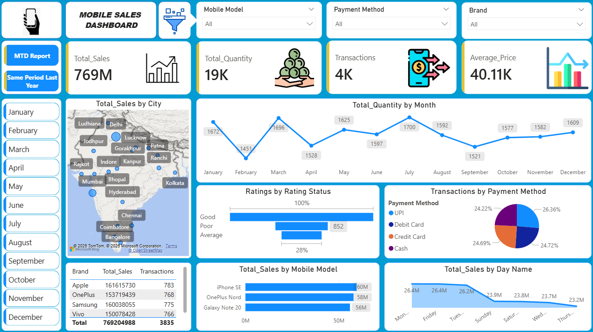
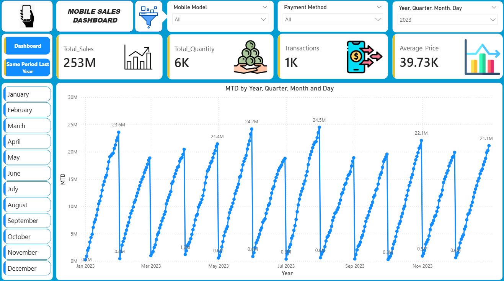
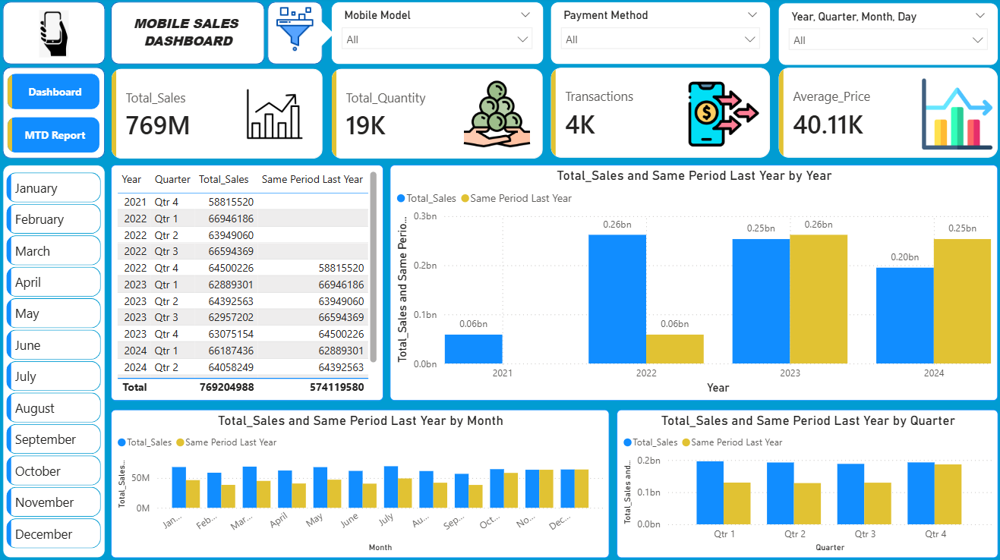

<div align="center">

# 📱 Mobile Sales Analysis Dashboard

A Power BI sales report covering revenue, product performance, customer ratings, payment mix, MTD, and SPLY views.


**Muhammad Ali Nawaz**  
Power BI Developer / Data Analyst

</div>

---

## 📌 Project Overview

This project uses a mobile-sales workbook and a Power BI report to explore sales performance across products, cities, payment methods, ratings, and time. The PBIX contains an overview dashboard, an MTD page, and a Same Period Last Year (SPLY) page. A presentation deck provides a narrative summary of the dashboard findings.

## 🎯 Business Questions

- How do sales and unit volumes change by month and year?
- Which brands, models, and cities contribute the most revenue?
- How are transactions distributed across payment methods?
- What do customer ratings show in the supplied data?
- How does current-period performance compare with MTD and prior-year views?

## 📊 Dataset Scope

| Data element | Supplied value |
| --- | ---: |
| Transaction rows | 3,835 |
| Unique transaction IDs | 3,835 |
| Total units sold | 19,150 |
| Revenue (`Units Sold × Price Per Unit`) | ₹769,204,987.97 |
| Mean `Price Per Unit` (unweighted) | ₹40,114.04 |
| Analysis years | 2021–2024 |

The workbook has 14 columns and no missing cells. Weekday labels use both full names and abbreviations; their three-letter forms match the dates reconstructed from the day, month, and year fields.

## ✨ Report Pages

- **Dashboard:** Revenue, units, transaction count, average price, city, month, rating, payment, brand, model, and weekday views.
- **MTD Report:** Cumulative sales progression through the selected year/month context.
- **Same Period Last Year:** Year, quarter, and month sales comparison visuals.

## 🖼️ Dashboard Screenshots

| Main dashboard | MTD report |
| --- | --- |
|  |  |

| SPLY report |  |
| --- | --- |
|  |  |

## 🧰 Technology Stack

| Technology | Use in this project |
| --- | --- |
| Microsoft Power BI Desktop | Interactive report pages and visuals |
| DAX | KPI, MTD, and SPLY calculations referenced by the report |
| Power Query | Data preparation in the PBIX |
| Microsoft Excel | Source sales workbook |
| PowerPoint | Presentation of the dashboard narrative |

## 📁 Project Structure

```text
Mobile-Sales-Dashboard/
├── Screenshots/
│   ├── Average 2.png
│   ├── Average.png
│   ├── Dashboard.png
│   ├── Filter.png
│   ├── MTD_Report.png
│   ├── Quanity.png
│   ├── SamePeriodLastYear.png
│   ├── Transactions.png
│   └── mainlogo.png
├── Mobile Sales Dashboard.pptx
├── Mobile Sales Data.xlsx
├── Mobile_Sales_Dashboard.pbix
├── LICENSE
├── README.md
└── .gitignore
```

## ✅ Validation Notes

- Workbook-derived revenue, units, leading brands, and leading models agree with the rounded dashboard figures.
- The displayed ₹40.11K is the unweighted mean of transaction-level `Price Per Unit`; revenue divided by units gives a weighted figure of approximately ₹40.17K. Keep the chosen definition explicit in the report.
- In the supplied SPLY screenshot, visible quarterly values appear shifted to the preceding displayed quarter. Validate the SPLY calculation and row-level comparison in Power BI Desktop before using the quarterly comparison as a business conclusion.
- The PBIX is supplied, but its complete DAX formulas, model relationships, and Power Query steps are not included as separate text files.

## 👤 Author

**Muhammad Ali Nawaz**  
Power BI Developer / Data Analyst

## 📄 License

This project is released under the [MIT License](LICENSE) for original project materials. Any third-party datasets or assets remain subject to their applicable terms.
